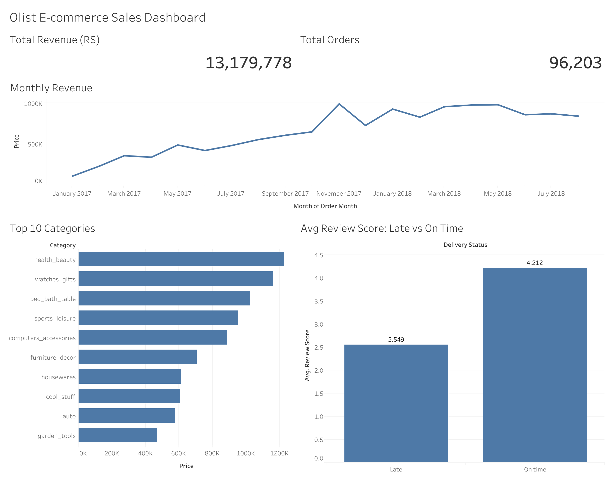

# Olist E-commerce Sales Analysis (MySQL + Tableau)

**Question:** How is this Brazilian marketplace performing, what sells, do customers come back, and does late delivery hurt reviews?

**Interactive dashboard:** [Tableau Public](https://public.tableau.com/views/OlistE-commerceSalesDashboard_17916351464820/OlistE-commerceSalesDashboard)

.

## Data
- [Olist Brazilian E-Commerce dataset](https://www.kaggle.com/datasets/olistbr/brazilian-ecommerce) (Kaggle): orders, items, customers, products, payments, reviews and sellers.
- All amounts are in Brazilian Real (R$).

## Method
- Loaded 8 CSV files into MySQL (`olist_import.sql`).
- Analysis in SQL with joins, CTEs and window functions (`olist_analysis.sql`).
- Exported a flat table of delivered orders from 2017 (`olist_dashboard_export.sql`) and built the dashboard in Tableau Public.

## Key findings
| Question | Result |
|---|---|
| Overall | 96,478 delivered orders, R$13.22M revenue, R$137.04 average order value |
| Top categories | health_beauty (R$1.26M), watches_gifts (R$1.21M), bed_bath_table (R$1.04M) |
| Repeat customers | 2,801 of 93,358 customers ordered more than once (3.0%) |
| Delivery vs reviews | On time: 88,652 orders, average review 4.29. Late: 7,700 orders, average review 2.57 |

1. **Late deliveries drive bad reviews.** About 8% of orders arrived late, and their average review was 1.72 points lower than on-time orders.
2. **Almost nobody comes back.** Only 3% of customers ordered a second time, so the business depends on winning new customers.
3. **Growth was strong in 2017.** Monthly revenue rose from R$111.8K in January 2017 to R$489.3K in May 2017.

The dashboard covers 2017 onward and averages review scores per item, so its figures (for example about 2.5 vs 4.2 stars) differ slightly from the SQL results above.

## Recommendations
1. Cut late deliveries, especially in the states with the most late orders, to protect review scores.
2. Add retention offers (discounts or reminder emails) for first-time buyers, since 97% never order again.
3. Put marketing spend behind the top categories, while testing growth in mid-ranked ones.

## Files
- `olist_import.sql`: creates the tables and loads the CSVs
- `olist_analysis.sql`: the five analysis queries
- `olist_dashboard_export.sql`: the table used by Tableau

## Tools
MySQL, SQL (joins, CTEs, window functions), Tableau Public
